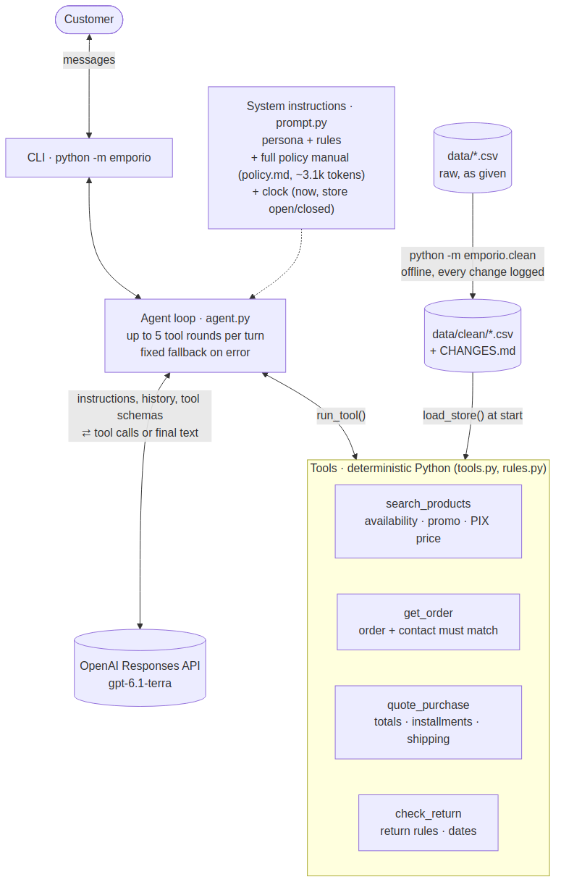

# Empório da Música — customer-service agent

A Python text agent for Empório da Música, a fictional musical-instrument
store in Campo Grande/MS. It answers customers in Brazilian Portuguese from
the store's policy manual and its data: catalog, stock, promotions and orders.

The model selects tools, writes their arguments and writes the reply. Python
code calculates every price, total, date and policy decision.

## Quick start

You need Python 3.12, [uv](https://docs.astral.sh/uv/) and an OpenAI API key.

```bash
uv sync                   # install the pinned dependencies into .venv
cp .env.example .env      # then set OPENAI_API_KEY in .env
uv run python -m emporio  # start a chat; press Ctrl-D to quit
```

Then ask the agent a question in Portuguese, as a customer does:

```text
Você: Quanto custa o Takamine GD20?
Empório: O Takamine GD20 Dreadnought Natural custa R$ 2.199,00.
         No PIX, fica por R$ 2.089,05. Está disponível! 🎸
```

Other useful commands:

| Command | Result |
|---|---|
| `uv run python -m emporio --transcript out.md` | Saves the conversation and its tool calls as Markdown |
| `uv run python -m emporio --model gpt-6-luna` | Uses a different model (default: `gpt-6.1-terra`) |
| `make test` | Runs 258 offline tests with coverage |
| `make lint` | Runs ruff, black and mypy `--strict` |
| `make eval` | Runs the 31 eval cases against the real model (paid API) |
| `uv run python -m emporio.clean` | Builds `data/clean/` again from the raw CSVs |

Optional settings in `.env`: `OPENAI_MODEL` and `REASONING_EFFORT` (default `low`).

## Architecture



For each customer message, the agent sends three items to the OpenAI
Responses API. These items are the system instructions, the conversation
history and the schemas of four tools. The system instructions contain the persona, the
rules, the full policy manual and the current time in Campo Grande. The
model can call tools for at most 5 rounds. Each tool is a Python function
over data that loads at start.

If the API fails, the answer is empty or the round limit occurs, the
customer gets a fixed message. That message gives the store's WhatsApp
number and hours. The agent never sends a guessed answer.

## Decisions and tradeoffs

**Plain OpenAI SDK, not LangChain or LangGraph.** The agent is one loop: call
the model, run the tools, repeat. The SDK does this in about 50 lines, and a
fake client tests it. A framework adds dependencies and a graph with one
node. A framework becomes useful when the flow has branches, for example a
handoff to a human queue.

**Responses API, not Chat Completions.** A live test before the plan found
that the gpt-5.6 and gpt-6.x models refuse function tools on Chat
Completions when reasoning is on. The agent uses `store=False`, so OpenAI
keeps no conversation state.

**Full manual in the prompt, not RAG.** The manual has 1,785 words
(approximately 3.1k tokens). Its rules refer to each other. For example, §3
gives the 5% PIX discount, and §6.2 says that this discount does not apply
to promotional prices. Retrieval can miss one of the two parts and saves
almost no tokens. Prompt caching makes the repeated tokens cheap. RAG
becomes useful above approximately 50k tokens of documentation.

**Four narrow tools, not a SQL agent.** A SQL agent lets the model write
queries, so the business rules move into model output. The four tools keep
the rules in code:

| Tool | Rules in code |
|---|---|
| `search_products` | Availability, active promotion, PIX price, reason for unavailability |
| `get_order` | Order details only for a matching order number and e-mail or phone |
| `quote_purchase` | Totals, PIX rule (§6.2), installment minimums (§3.1), shipping (§5), split payment |
| `check_return` | Return and exchange rules (§4), day counts from the customer's own dates |

**No calculations by the model.** The tools also format money (`R$ 2.199,00`)
and dates (`28/02/2026`), and the model copies them. Before this change, the
model calculated correctly in the tested cases. After the change, code
calculates the values.

**Data cleaned offline.** The raw CSVs stay as given. `emporio/clean.py`
writes `data/clean/` and logs each change in
[`data/clean/CHANGES.md`](data/clean/CHANGES.md). The runtime reads only the
clean data. The fixes for the contradictions in the manual are in the same
log.

**Model: `gpt-6.1-terra` with low reasoning effort.** On 2026-11-01 its price
was $1.00 per million input tokens and $5.00 per million output tokens.
`gpt-6-luna` costs one tenth of that. In the evals, it broke more
presentation rules, for example the original price next to a promotional
price.

**CLI and history in memory.** The challenge puts the focus on the agent, so
the interface is a command line. The history stays for one session, which
is sufficient for follow-up questions.

### What code enforces, and what the prompt only requests

| Behavior | Enforced by |
|---|---|
| No order data without a matching contact | Code (`get_order`) |
| No sale of unavailable products | Code (`search_products`, `quote_purchase`) |
| Accurate prices, totals, installments, shipping, return windows | Code (`rules.py`, `tools.py`) |
| No guessed answer after an API error | Code (`agent.py` fallback) |
| The model uses the tools and copies their values | Prompt only. The evals measure it. |
| No promises of actions the agent cannot do ("registrei", "aprovado") | Prompt only. The evals measure it. |

The contact check shows that the caller knows the order's e-mail or phone.
It does not prove that the caller is the customer.

### Main assumptions

- Contact: (67) 3341-4444 and `contato@emporiodamusica.com.br`. The manual
  also gives (67) 3321-4500 and an e-mail address with an accent. The cover
  page agrees with the values above.
- Installments: the §3.1 minimums (R$ 50 up to 3x, R$ 80 up to 6x, R$ 100 up
  to 12x). The §3 table gives a different minimum.
- Six product descriptions name a different brand. For example, the "Korg"
  description says "Roland, 88 teclas", and its specs say 61 keys. The
  cleaning step removes these descriptions.
- "Acima de R$ 500" and "acima de R$ 2.000" mean "more than". The metropolitan
  region is the city of Campo Grande.

[`data/clean/CHANGES.md`](data/clean/CHANGES.md) lists all other changes.

## Evaluation

[`evals/cases.toml`](evals/cases.toml) has 31 frozen customer conversations.
The graders are deterministic. They check the tool calls, the exact money
values and the text of the reply. Each case also has good and bad sample
replies. CI makes sure that each grader accepts the good ones and rejects
the bad ones.

Final results on case set v9, 3 runs per model:

| Model | Score |
|---|---|
| `gpt-6.1-terra` | 30, 31, 31 of 31 |
| `gpt-6-luna` | 28, 27, 29 of 31 |

Earlier results on case set v5, before and after the move of all
calculations into tools (`gpt-6.1-terra`). This comparison uses v5 only,
so do not compare it with the v9 scores above:

| Code | Score |
|---|---|
| Before: the model calculated (commit `b62fb39`) | 26 of 31 |
| After: the tools calculate (commit `09dafa7`) | 30, 30, 31 of 31 |

The 5 cases that failed before are the cases that require the new tools.

I read all failed replies. Each remaining failure is an agent error. On
case set v8, four regexes rejected right replies. For example, a regex
accepted "passou" but not its plural "passaram". Case set v9 fixes these
regexes. `uv run python -m evals.regrade` graded the stored v8 replies
again, without new API calls. [`evals/results/`](evals/results/) contains
all runs, with fingerprints of the code and data that produced them.

## Example conversations

1. [Guitars up to R$ 1.000](examples/01-violoes-ate-1000.md): catalog search and a recommendation
2. [Price, PIX, installments and shipping](examples/02-preco-pix-parcelamento.md): values from `quote_purchase`
3. [Order status](examples/03-status-pedido.md): contact check and a late delivery
4. [Return request](examples/04-devolucao.md): §4.1 rules, missing facts, `check_return`
5. [Out of scope](examples/05-fora-do-escopo.md): accessories, an unrelated question, a prompt injection, a product not in the catalog

## Limitations and next steps

- The prompt controls tool use, copied values and refusals. The evals
  measure this behavior, but nothing guarantees it.
- The eval set is small (31 cases), the author wrote it, and some regex
  graders give wrong results. Next step: an LLM judge with hand-labeled
  checks, in addition to the regexes.
- Rounding: `quote_purchase` rounds each installment value separately, so
  the installments can differ from the total by some cents. For several
  items in one order, it rounds the PIX price per unit and then adds.
- `check_return` refuses an exchange by preference for a customized item or
  a "venda final" item (§4.4). The agent does not ask about these two facts.
  It applies them only when the customer mentions them.
- The contact check is not authentication. Next step: a WhatsApp channel,
  where the phone number identifies the customer and keeps the history.
- The agent cannot open a ticket, record a complaint or start a return. It
  gives the team's contact instead. Next step: a ticket that the team gets.
- The opening hours do not include holidays. The agent cannot quote
  shipping outside Campo Grande, because the data has no weights or sizes.
- `gpt-6.1-terra` has no dated version, so results can change over time.

## How I used AI assistants

I used Claude Code (Opus 5.5) to build the project and Codex
(GPT-6.1-Sol) as an independent reviewer.

1. Claude read the challenge, the data and the manual, asked me questions
   and wrote a spec. Codex reviewed the spec.
2. Claude tested the real API before the plan, then wrote a plan. Codex
   reviewed the plan.
3. Claude subagents did the mechanical tasks (project setup, CLI), each with
   a separate review. Claude wrote the data, tools, rules, prompt and evals
   in the main session, test first.
4. A Claude review of the full branch and a second Codex review found eval
   gaps. Claude reproduced each finding before the fix.

I read the eval failures, the example conversations and each review finding
myself before I accepted a change.
